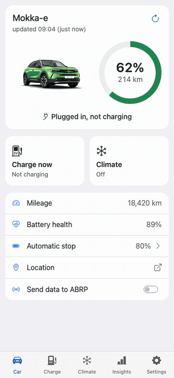
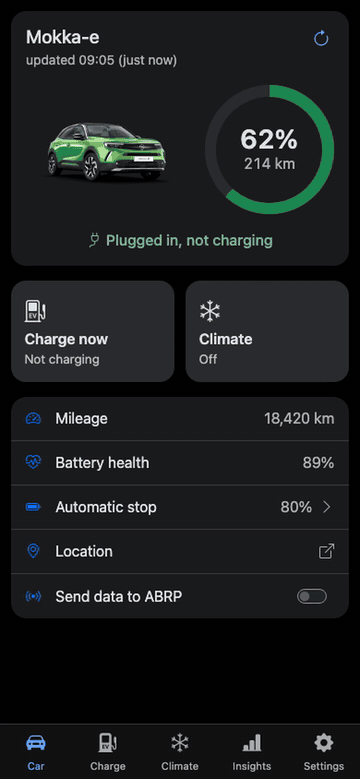

# Remote Control of PSA car: NEXT version, work in progress
[](https://app.codacy.com/gh/flobz/psa_car_controller?utm_source=github.com&utm_medium=referral&utm_content=flobz/psa_car_controller&utm_campaign=Badge_Grade_Settings)
[](https://www.codacy.com/gh/flobz/psa_car_controller/dashboard?utm_source=github.com&utm_medium=referral&utm_content=flobz/psa_car_controller&utm_campaign=Badge_Coverage)
[](https://hub.docker.com/repository/docker/flobz/psa_car_controller)
[](https://www.paypal.com/donate?hosted_button_id=SM652WPXFNCXS)

> **Please [test this version](#how-to-test-next) and [send your feedback](https://github.com/gsparber/psa_car_controller/issues).** So far it has only been tested with an Opel Mokka-e.

<p align="center">
  
  
</p>
<p align="center"><em>Demo data, simulated car.</em></p>

## How to test `next`

`next` is a test version in Docker, for amd64 and arm64. There is no image for 32-bit Raspberry Pi, and the Home Assistant add-on can't use it yet.

Each version comes as `4.0.0-next` and as `4.0.0-next-slim`. The slim image has no browser for the automatic login and is less than half the size, for small machines such as a Raspberry Pi: log in through a [login worker](docs/login_worker.md) or the manual link instead, see [Docker](docs/Docker.md#slim-image).

Keep your config folder: you need no new login or SMS activation. Never run two instances on the same config, they would share the same tokens. The web pages and the API have no login, so keep port 5000 inside your LAN.

### 1. Back up first

Stop the container and copy the whole config folder. Please don't skip this step:

```
docker compose down
cp -a ./config ./config.backup
```

### 2. Change the Docker image

In `docker-compose.yml`:

```diff
-    image: flobz/psa_car_controller:latest
+    image: ghcr.io/gsparber/psa_car_controller:4.0.0-next
```

```
docker compose pull
docker compose up -d
```

Without compose, replace the container and use your usual options:

```
docker rm -f psa_car_controller1
docker run -d --name psa_car_controller1 \
  --publish 5000:5000 \
  -v /host_path/config:/config \
  --restart unless-stopped \
  ghcr.io/gsparber/psa_car_controller:4.0.0-next
```

The header and Settings show the commit of the image. Please name it in your feedback.

A versioned tag such as `4.0.0-next` stays on one build, and [Renovate](https://docs.renovatebot.com/) proposes the next version (`4.0.1-next`) when there is one. The tag `next` (and `next-slim`) always moves to the newest version: with it, run `docker compose pull` and `docker compose up -d` again to update.

### What changes in your data

| File | Change | Can v3.7.10 still use it? |
|---|---|---|
| `info.db` | Table `battery_soh`: unique per date instead of per value, so that a SOH value can be recorded again. Migrated at the first start, no rows are lost, and PSACC saves `info_backup_<date>.db` in the config folder first | Yes, it reads and writes the migrated database |
| `cars.json` | New field `precond_programs` | **No**, it finds no car in this file, see below |
| `config.ini` | New sections and options | Yes |

Checked offline with the images and sample data (v3.7.10 → `next` → v3.7.10), not yet with a real account. Versions older than v3.7.10 were not tested.

### Go back to the release

Restore `cars.json` only, the database can stay:

```
docker compose down
cp ./config.backup/cars.json ./config/cars.json
```

Set the image back to `flobz/psa_car_controller:latest`, then run `docker compose pull` and `docker compose up -d`.

Don't restore `config.json` or `otp.bin`: the tokens change while PSACC runs, and old ones can force a new login. The number of SMS activations is limited, see the [FAQ](FAQ.md#2-error-during-activation).

## This is a Python program to control and get information from a PSA car.
I test it with a Peugeot e-208, but it works with other PSA vehicles (Citroen, Opel, Vauxhall, DS).

With this app you will be able to:
 - get the status of the car (battery level for electric vehicle, position ... )
 - start and stop the charge
 - set a charge threshold to limit the battery level to a certain percentage
 - set a stop hour to charge your vehicle only on off-peak hours
 - control air conditioning
 - control lights and horn if your vehicle is compatible
 - lock and unlock doors
 - get consumption statistics
 - visualize your trips on a map or in a table
 - get the list of car charging  
 - visualize battery charging curve
 - visualize altitude trip curve
 - get car charging CO2 emission
 - get car charging price
 - send live data to ABetterRoutePlanner

The official API is documented [here](https://developer.groupe-psa.io/webapi/b2c/quickstart/connect/#article) but it is not totally up to date, and contains some errors. 


 ## I. Installation
- [Installation on Linux or Windows](docs/Install.md)
- [Installation as Home Assistant addon](https://github.com/flobz/psacc-ha/blob/main/psacc-ha/README.md)  
- [Installation in Docker](docs/Docker.md)
- [Installation on Raspberry Pi with docker-compose (external Tutorial)](https://return2.net/opel-peugeot-electric-vehicle-set-charging-threshold-limit/)
 ## II. Use the API

Look at [API documentation](./docs/psacc_api.md)

## III. Use the dashboard

You can add the -r argument to record the position of the vehicle and retrieve this information in a dashboard.

``python3 psa-car-controller -f config.json -c charge_config.json -r``
    
You will be able to visualize your trips, your consumption and some statistics:
    
     

- You have to add an API key from https://home.openweathermap.org/ in your config file, to be able to see your consumption vs exterior temperature.
- You have to add an API key from https://co2signal.com/ to have your CO2 emission by KM (in France the key isn't needed). 
### IV. Charge price calculation
The dashboard can give you the price by kilometer and price by kw that you pay.
You just have to set the price in the config file.

After a successful launch of the app, a config.ini file will be created.
In this file you can set the price you pay for electricity in the following format "0.15".

If you have a special price during the night you can set "night price", "night hour start" and "night hour end". 
Hours need to be in the following format "23h12".

You can modify a price manually in the dashboard. It can be useful if you use public charge point.
## V. Connection to other services:
- [Domoticz](docs/domoticz/Domoticz.md)
- Home Assistant through your own MQTT broker (MQTT discovery), see [this page](docs/home_assistant_mqtt.md)
- [HomeAssistant](https://github.com/Flodu31/HomeAssistant-PeugeotIntegration)
- Jeedom (Anyone can share the procedure ?)
- You can send live car status to ABRP (A better Route Planner), see [this page](docs/abrp.md)
- evcc, without giving it a token of its own, see [this page](docs/evcc.md)
- [Grafana](https://github.com/flobz/psa_car_controller/issues/161)

## FAQ
If you have a problem or a question, please check if the answer isn't already in the [FAQ](FAQ.md). 

## Contribute
If you need information to contribute or edit this program go [here](docs/Develop.md).

## Donation
If you want to thank me for my work :smile:

[](https://www.paypal.com/donate?hosted_button_id=SM652WPXFNCXS)

## Acknowledgements
- thanks to @tamcore for https://github.com/tamcore/stelloauth 

## Before merging upstream
The release pipeline publishes the images to the GHCR of this fork. Switch it back to Docker Hub first, see the TODO at the top of [release.yml](.github/workflows/release.yml). Then remove the NEXT title, the test note, the demo GIFs, "How to test `next`" and this section.